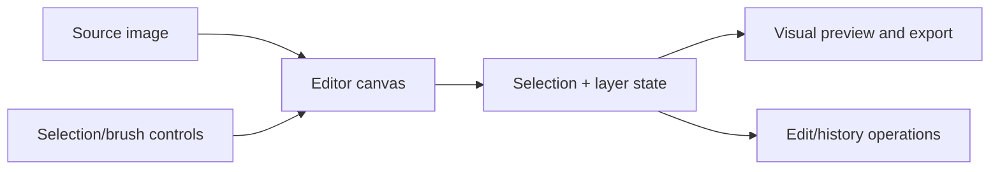

# STUDIO · VISUAL SELECTION WORKBENCH

### A useful image editor preserves the meaning of a selection.

**Visual authoring · reproducible masks · editable canvas state**

Image editing becomes difficult to verify when tools only change the displayed pixels. A serious editor should preserve the selected region, its tolerances, the layer it belongs to and the operation that produced it.

**STUDIO · VISUAL SELECTION WORKBENCH** is an experimental source project investigating this workflow. A Next.js and Firebase Studio experimental interface with an application layout, canvas area, left/right controls, magic-wand and lasso settings, segmented selection groups, layers, and an analytics panel. The source is a UI/editor prototype, not a verified autonomous computer-vision system.

> **Implementation boundary:** the components are present in the Git repository. The application was **not newly built or rendered** during this documentation pass. Feature presence, a working UI and independently measured selection quality are three different evidence levels.

**Source:** [layout.tsx](src/components/app/layout.tsx) · [canvas-area.tsx](src/components/app/canvas-area.tsx) · [left-sidebar.tsx](src/components/app/left-sidebar.tsx) · [right-sidebar.tsx](src/components/app/right-sidebar.tsx)

---

## What this repository contains



| Responsibility | Current source direction |
|---|---|
| **Canvas** | Browser image pixels, pointer input and editor transforms |
| **Selections** | Magic-wand and/or lasso interactions with explicit parameter controls |
| **Layers** | Independent compositing and visibility state |
| **History** | Undo/replay metadata where implemented by the editor |
| **Visualization** | Editor panels and user feedback, not an independent accuracy certificate |

## Start from source

```bash
npm install
npm run dev
```

This is a Next.js app; use the local URL reported by the development server. A successful bundler run is not evidence that every editing gesture or integration works.

## Qualification work

The next meaningful test is an actual Next.js browser session using reference images: add/avoid masks, tolerance changes, lasso paths, overlap prevention, copy-to-layer, undo and export. Automated segmentation precision and any AI functionality must be measured rather than inferred from control names.

**The goal is an editor whose operations can be inspected and reversed, not merely a UI whose effects seem plausible.**

---

*The boilerplate README has been replaced with source-specific documentation. No editor source files were changed.*
